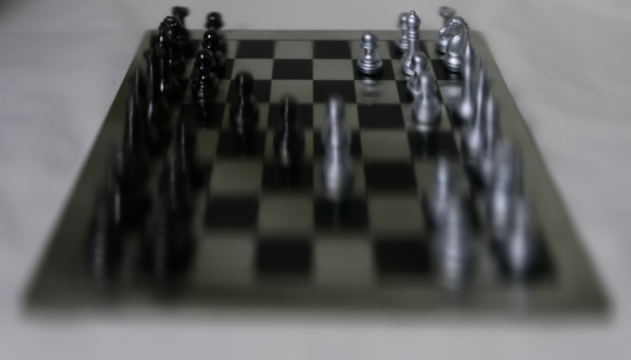

# Lab 7 final submission

The TA approved using the supplied chessboard image, as reported by the student.
The image below is the supplied input; it was not captured by our Jetson.

## Submitted files

- [Eight implemented analysis functions and image/camera runner](frames.py)
- [Generated image statistics and memory report](output/frame_report.json)
- [Tests](test_frames.py) and [saved local results](test-results.txt)
- [Work log and requirements review](IMPLEMENTATION_NOTES.md)
- [Hardware status and approved alternative](hardware_status.json)
- [1080p pre-lab predictions](prelab_predictions.json) (separate from this image)
- [Instructor reference artifacts](reference_output/) (separate from our results)

## Reproduce the submission

From lab07 on the Jetson:

    python3 frames.py --image output/all_focus_s1_1.0_s2_3.0.png --output-dir output
    python3 -m unittest -v test_frames.py

OpenCV and NumPy are needed for image analysis; the Jetson already has both.
The math and diagnostic unit tests need only Python. Image integration tests
skip if OpenCV/NumPy are unavailable. All 21 tests passed locally and on the Jetson with both installed.
The Jetson run took 0.509 seconds and produced the submitted frame report.

## Results for the supplied image

| Measurement | Result |
|---|---:|
| Dimensions | 700 x 400 |
| Luma samples | 280,000 |
| Classification | scene |
| Minimum luma | 0.003922 |
| Maximum luma | 0.960784 |
| Mean luma | 0.366944 |
| Population standard deviation | 0.221170 |
| Spread | 0.956863 |
| BGR bytes/frame | 840,000 |
| NV12 bytes/frame | 420,000 |
| BGR bytes/second at assumed 30 FPS | 25,200,000 |
| NV12 bytes/second at assumed 30 FPS | 12,600,000 |
| NV12 to BGR read + write | 1,260,000 |
| RGB resize to 224 x 224 read + write | 990,528 |
| Full-resolution uint8 to FP32 read + write | 4,200,000 |

The report preserves the starter's three main sections. Metadata identifies
input_source as supplied_image and records the original PNG SHA-256. Pixel
statistics are computed from the decoded supplied image using OpenCV grayscale
and normalized float32 luma. Memory rates are estimates at assumed FPS; no live
camera throughput, latency, sensor health, or working camera feed is established.
The scene label describes the image's brightness/contrast, not the local sensor.
PNG disk file size differs from the uncompressed frame footprint.

The physical camera troubleshooting is no longer a submission prerequisite
under the student's reported TA approval. After this submission was finalized, the user requested camera setup.
Jetson-IO enabled the IMX219 Dual CSI profile; after reboot, OpenCV read
20 valid 960 x 540 BGR frames. No new photo was saved and the approved supplied
image remains the submitted input. See CAMERA_SETUP.md for the procedure.
