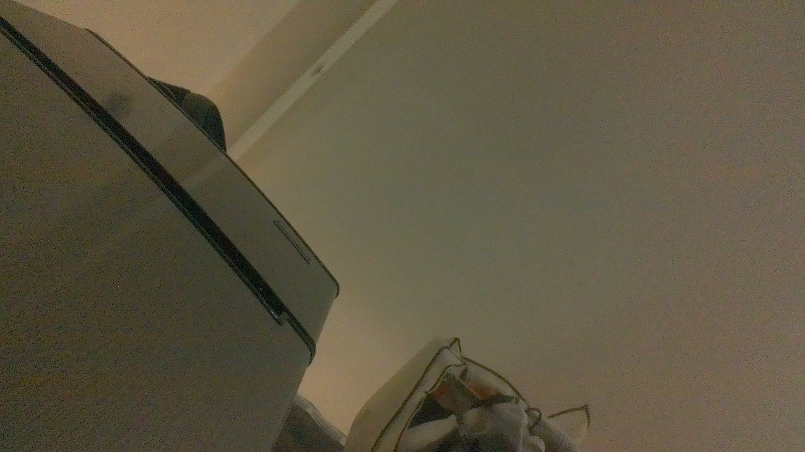

# Lab 7 final submission - live camera capture

The submitted image is a fresh photograph from the Jetson CSI camera, taken
after the student explicitly confirmed readiness on October 21, 2026.
It replaces the earlier TA-provided chessboard image and its analysis.

## Files

- [Eight implemented functions and report runner](frames.py)
- [Original captured JPEG](output/captured_frame.jpg)
- [Image statistics and memory report](output/frame_report.json)
- [21 tests](test_frames.py) and [local run](test-results.txt)
- [Capture and verification provenance](final_verification.json)
- [Camera configuration fix](CAMERA_SETUP.md)
- [Requirements and work log](IMPLEMENTATION_NOTES.md)
- [1080p pre-lab predictions](prelab_predictions.json) (separate example)
- [Instructor reference image/report](reference_output/) (not our results)

## Reproduce the submitted report without taking another picture

From lab07:

    python3 frames.py --image output/captured_frame.jpg --image-origin live_camera_capture --output-dir output
    python3 -m unittest -v test_frames.py

OpenCV and NumPy are required for image analysis; the Jetson already has both.
The core arithmetic tests use standard Python. Image integration checks skip
when image libraries are unavailable. All 21 tests passed locally and on the Jetson (0.702 seconds, no skipped tests).

## Actual capture

The supplied take_selfie.capture_image function captured the source using
sensor-id=0, a 1920 x 1080 NV12 sensor stream, nvvidconv to 960 x 540 BGRx,
videoconvert to BGR, and appsink. The script read ten warmup frames before
saving the next frame as JPEG. The captured file was copied byte-for-byte to
output/captured_frame.jpg. The saved JPEG was then decoded for the submitted
analysis; these are post-JPEG statistics, not raw sensor-pixel statistics.

The original timestamped file is retained on the Jetson as
output/live_capture_20261021_135556.jpg. No second photo was taken for analysis.
The previous TA-provided image remains in Git history, not the current output.

## Results for our photograph

| Measurement | Result |
|---|---:|
| Output dimensions | 960 x 540 |
| Grayscale samples | 518,400 |
| Classification | scene |
| Minimum / maximum luma | 0.000000 / 1.000000 |
| Mean luma | 0.307890 |
| Population standard deviation | 0.192460 |
| Spread | 1.000000 |
| BGR bytes/frame | 1,555,200 |
| NV12 bytes/frame at this output size | 777,600 |
| BGR bytes/second at assumed 30 FPS | 46,656,000 |
| NV12 bytes/second at assumed 30 FPS | 23,328,000 |
| NV12 to BGR read + write | 2,332,800 |
| RGB resize to 224 x 224 read + write | 1,705,728 |
| Full-output-size uint8 to FP32 read + write | 7,776,000 |

The photograph contains a range of bright and dark areas and passes the stated
scene thresholds. Bright ceiling lights reach full-scale white; the classifier
is a simple brightness/contrast check and does not establish perfect exposure.
The memory rates are calculated at assumed 30 FPS, not measured throughput.
The sensor pipeline starts at 1080p; this report prices the saved 960 x 540 frame.
Its NV12 comparison is hypothetical at that output size, not a claim about
all upstream CSI/ISP traffic. JPEG file bytes differ from uncompressed bytes.

## Camera status

The IMX219 Dual profile was enabled for the 22-pin CSI connector via Jetson-IO,
and the board rebooted once. /dev/video0 and working OpenCV frames appeared.
The original boot configuration is backed up, and the primary boot entry remains.
