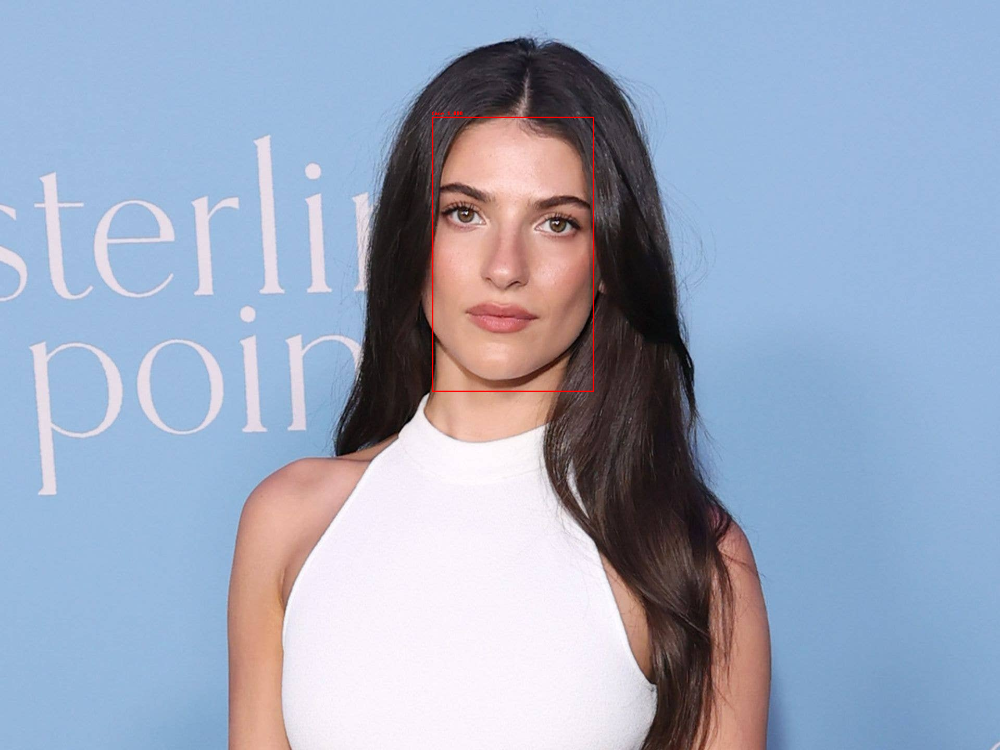
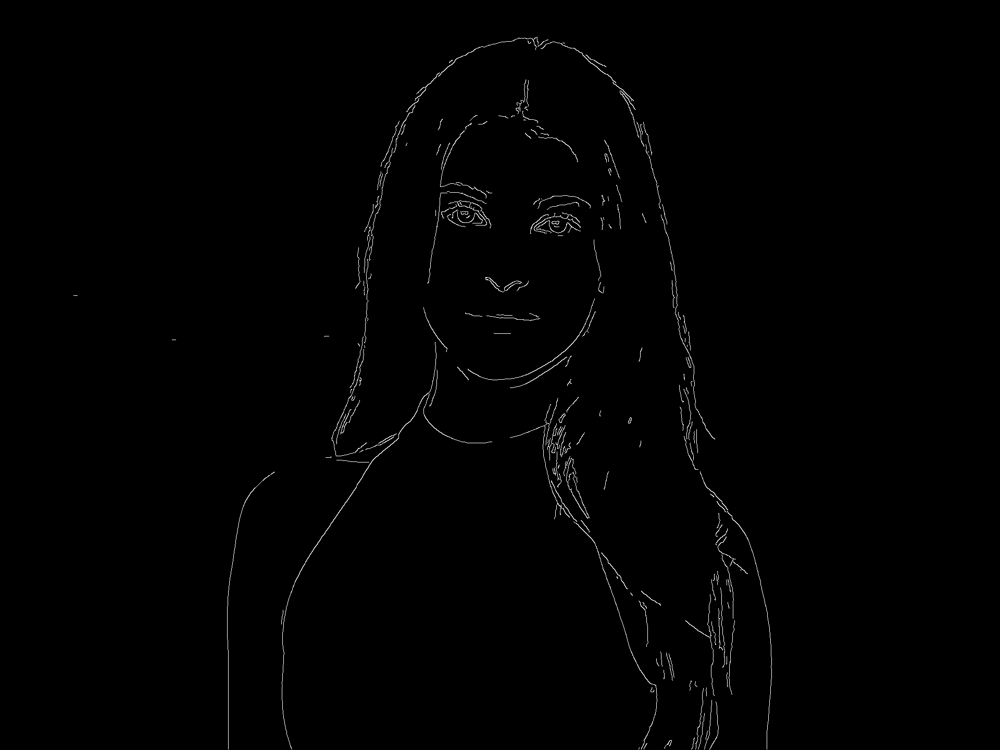

# Lab 8 submission

All five functions are implemented in [detect_face.py](detect_face.py).
The instructor's supplied face.jpg and RFB-320 ONNX model were used; no new
camera image was captured and no person is identified by the code.

## Results

- One face detected, confidence approximately 0.99985.
- Pixel box: [829, 224, 1140, 752] on the original 1920 x 1440 image.
- Inference used CPUExecutionProvider. CUDA inference is not claimed.
- The default SciPy edge pipeline follows the handout's single-pass hysteresis.
- Canny: 16,508 edge pixels; exact pixel match to the instructor edge sample.
- All 15 tests passed on the Jetson in 0.054 seconds.
- Face-box IoU against the sample outline is approximately 0.993.

## Evidence and work log

- [Structured results](results.json)
- [Sample comparison](sample_comparison.json)
- [15 unit tests](test_detect_face.py) and [Jetson test run](test-results.txt)
- [Runtime environment and model checksum](environment.json)
- [Implementation steps and decisions](IMPLEMENTATION_NOTES.md)

The face outline is compared with the green rectangle inferred from the
sample image, not a labeled ground-truth dataset. Annotation colors/text differ
and box coordinates differ by about one pixel. This is not an accuracy benchmark.

## Run on this Jetson

    cd /home/student/ENEE459L/lab08
    sh run_lab08.sh
    sh run_lab08.sh -m unittest -v test_detect_face.py
    sh run_lab08.sh compare_outputs.py

The launcher uses the optional dependency folder ~/lab08-deps and system SciPy
and Pillow. The board's old Pillow is supported without a system upgrade.
To recreate only the extra dependency folder with the existing system stack:

    python3 -m pip install --target ~/lab08-deps --no-deps -r requirements-jetson-extra.txt

This command assumes system SciPy, Pillow, packaging, protobuf, and sympy are
already present, as verified on the board. It does not replace system NumPy or
PyTorch. For a fresh isolated Python environment elsewhere, use requirements.txt.
The attempted ~/lab08-env virtual environment was not used because the board
lacks ensurepip; the successful setup is ~/lab08-deps.

## Algorithms

hard_nms keeps the highest scores and suppresses boxes with IoU strictly above
0.3, after limiting to the top 200 candidates. detect_faces preprocesses RGB to
float32 (1,3,240,320), runs the model, filters at confidence 0.7, and annotates.
Canny applies Gaussian sigma 1.4, the handout's Sobel kernels, magnitude scaling,
four-direction NMS, and low/high thresholds 20/60.

The handout's one-pass hysteresis promotes weak pixels adjacent to currently
strong pixels. It is order-dependent; it is not full transitive edge tracking.
A full-connectivity exploratory implementation retained extra weak chains, so
it was replaced by the literal procedure that matches the instructor example.
